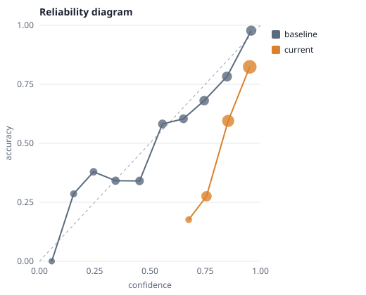

# calibration-ci

[](https://github.com/kishoren18-hue/calibration-ci/actions/workflows/ci.yml) [](LICENSE)

**Unit tests for model confidence.** A GitHub Action, CLI and pytest plugin that fails your build when a prompt change, fine-tune or model upgrade makes the model's confidence less trustworthy, even if accuracy stays flat.

Teams that ship LLM features usually test accuracy on an eval set. Almost nobody tests whether the model's confidence stayed honest. That gap matters because confidence is what downstream systems act on: it decides when to auto-approve, when to escalate to a human, and when to show a warning. A change can keep accuracy identical while making the model badly overconfident, and an accuracy-only suite will pass it.

```
### ❌ Calibration regression

500 paired items

| metric | baseline | current | change | 95% CI of worsening | allowed | status |
|---|---|---|---|---|---|---|
| ece (lower is better) | 0.057 | 0.251 | +0.194 | [+0.140, +0.217] | 0.020 | regressed |
| brier (lower is better) | 0.182 | 0.266 | +0.084 | [+0.061, +0.110] | 0.010 | regressed |
| auroc2 (higher is better) | 0.788 | 0.780 | -0.009 | [-0.008, +0.028] | 0.020 | ok |
| accuracy (higher is better) | 0.622 | 0.622 | +0.000 | [-0.000, -0.000] | 0.020 | ok |
| overconfidence | 0.018 | 0.251 | +0.233 | n/a | info |  |
```

That output is real, produced from the example runs in `examples/`: accuracy is unchanged, confidence got pushed toward 100%, and the check fails. The reliability diagram the action produces for the same runs shows the problem at a glance:



## Use it as a GitHub Action

```yaml
# .github/workflows/calibration.yml
name: calibration
on: [pull_request]
permissions:
  contents: read
  pull-requests: write        # only needed for comment-on-pr
jobs:
  calibration:
    runs-on: ubuntu-latest
    steps:
      - uses: actions/checkout@v5
      - name: Run your eval
        run: python run_eval.py --out evals/current.jsonl   # your code
      - uses: kishoren18-hue/calibration-ci@main
        with:
          baseline: evals/baseline.jsonl
          current: evals/current.jsonl
          comment-on-pr: true
```

What you get on every pull request:

* the comparison table in the job summary,
* the same table as a PR comment (updated in place on each push) when `comment-on-pr: true`,
* a `calibration-ci-<job>` artifact with `results.json` and `reliability.svg`,
* a `regressed` output you can use in later steps.

| Input | Default | Meaning |
|---|---|---|
| `baseline` | required | baseline JSONL |
| `current` | required | candidate JSONL |
| `config` | none | TOML/JSON policy file |
| `comment-on-pr` | `false` | post/update a PR comment |
| `upload-diagram` | `true` | upload the diagram and JSON as an artifact |
| `python-version` | `3.12` | Python used to run the checker |

## Use it from the command line

```bash
pip install git+https://github.com/kishoren18-hue/calibration-ci
calibration-ci report evals/current.jsonl
calibration-ci compare --baseline evals/baseline.jsonl --current evals/current.jsonl \
    --svg reliability.svg --markdown comment.md --json results.json
```

Exit code 0 means OK, 1 means a regression, 2 means bad input.

## Use it in pytest

Installing the package registers a `calibration` fixture:

```python
def test_confidence_did_not_get_worse(calibration):
    calibration.check("evals/baseline.jsonl", "evals/current.jsonl", ece=0.02, auroc2=0.03)
```

## Input format

One JSON object per line, one line per eval item:

```json
{"id": "q0001", "correct": 1, "confidence": 0.87}
```

Runs are joined on `id`, so the comparison is paired: each item is compared with itself. Items present in only one run are reported and ignored.

## How a regression is decided

For each metric in the policy, a regression requires both:

1. the observed worsening exceeds the allowed threshold, and
2. a paired bootstrap 95% confidence interval for the worsening lies entirely above zero.

The second rule keeps small eval sets from producing flaky failures. Turn it off with `--no-significance` if you want strict thresholds.

Default thresholds (absolute): ECE +0.02, Brier +0.01, type-2 AUROC -0.02, accuracy -0.02. Override them with a `calibration-ci.toml` at the repo root:

```toml
[thresholds]
ece = 0.015
auroc2 = 0.03

[options]
n_boot = 2000
require_significance = true
```

## Metrics

| Metric | Measures |
|---|---|
| ECE | Whether stated confidence matches accuracy on average (equal-width bins) |
| Brier | Combined accuracy and calibration of the probabilities |
| Type-2 AUROC | Whether confidence separates right answers from wrong ones |
| Accuracy | Included so you can see calibration changes in context |
| Overconfidence | Mean confidence minus accuracy (informational) |

ECE alone can hide a model that is "calibrated" only because its confidence is nearly constant. Type-2 AUROC catches that, which is why both are checked by default. For deeper analysis (meta-d', M-ratio), see the companion library [metad-llm](https://github.com/kishoren18-hue/metad-llm).

## Design notes

* No runtime dependencies on Python 3.11+ (tomli on older versions), so the action installs in seconds.
* Deterministic: bootstrap uses a fixed seed (configurable).
* The baseline is just a file in your repo. Updating it is a reviewed commit, which is the point.

## Why I built this

My research is on calibration in language models. Working on it, I noticed that the confidence numbers papers report are measured once, while the models behind real products change every week. Accuracy gets regression tests; confidence almost never does. This is the smallest tool that closes that gap, and it's the same kind of check I want in any AI product I build.

## Development

```bash
pip install -e ".[dev]"
pytest -q
python examples/make_examples.py   # regenerate example runs
```

## Contributing

Issues and pull requests are welcome. See [CONTRIBUTING.md](CONTRIBUTING.md) for setup and ideas to start with, [CHANGELOG.md](CHANGELOG.md) for what's new, and [SECURITY.md](SECURITY.md) to report a problem privately. If you use this in research, GitHub's "Cite this repository" button (from [CITATION.cff](CITATION.cff)) gives a ready-made citation.

## License

MIT
